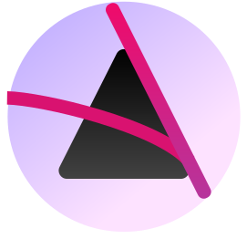
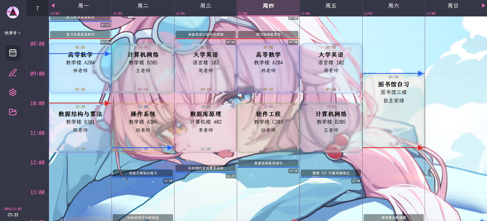
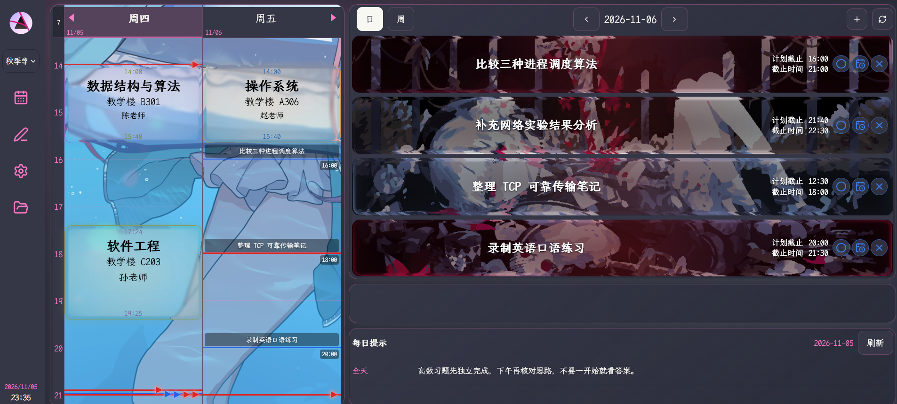
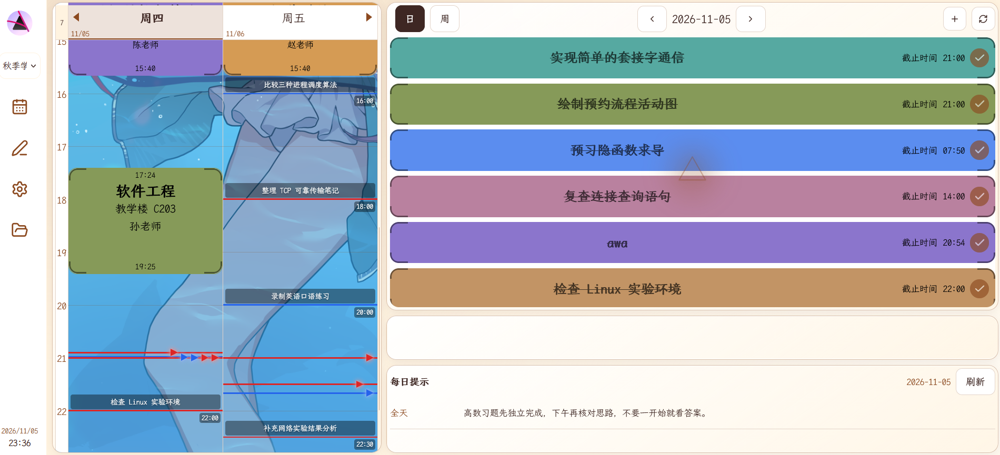

<h1 align="center">
  Y u  T D
</h1>

<p align="center">结合课程表与待办事项的通用日程规划软件，实用、多端，还有可爱!（？</p>

<p align="center"><a href="https://yutd.yumolf.top">在线演示</a></p>

<p align="center">
  
</p>
<p align="center">
  
  
</p>

## TodoList

- [ ] i18n
- [ ] 桌面端
- [ ] 安卓端

## 部署方式

### 开发者

```bash
bun install
bun dev
```

### 生产运行

```bash
bun run build
bun start
```

# Contributions are welcome!
